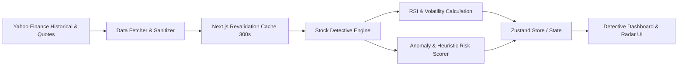

# Stock Detective (Borsa Analizi) — Real-Time Market Anomaly & Risk Radar

A quantitative stock analysis dashboard built with **Next.js** and **TypeScript** that monitors market movements, calculates technical health metrics, and flags high-risk anomalies across equities using automated heuristics.

---

## Key Features

- **Automated Market Detective Engine:** Continuously tracks equities to spot unusual volatility, RSI divergences, and sudden volume surges.
- **High-Performance In-Memory Caching:** Implements Next.js `unstable_cache` with a 300-second revalidation window to minimize Yahoo Finance rate-limiting and maximize responsiveness.
- **Dynamic Risk Scoring:** Algorithmic calculation evaluating 60-day price trends, volatility bands, and moving averages to output structured risk scores and human-readable risk rationales.
- **Interactive Multi-Asset Dashboard:** Real-time charts, global market radars, watchlists, and anomaly heatmaps.
- **Full Localization (i18n):** Multi-language support (English, Turkish, German) via `next-intl`.

---

## Technical Architecture



---

## Tech Stack

- **Framework:** Next.js (App Router, Server Components)
- **Language:** TypeScript
- **Market Data:** `yahoo-finance2`
- **State Management:** Zustand
- **Internationalization:** `next-intl` (en, tr, de)
- **Styling:** Tailwind CSS, PostCSS

---

## Getting Started

### 1. Installation

```bash
git clone https://github.com/mmkaya-ui/analizborsa.git
cd borsa
npm install
```

### 2. Run the App

```bash
npm run dev
```

Visit [http://localhost:3000](http://localhost:3000) to inspect real-time market data.
